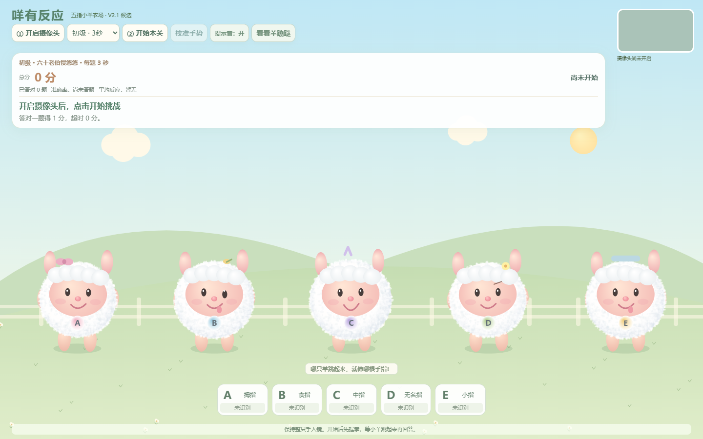

# 咩有反应 · Sheep Reaction V2.0

面向久坐办公人群休息间隙的趣味手指活动与协调挑战。通过摄像头识别手势，让五只小羊陪你挑战三关。

这是娱乐游戏，没有医学验证，不用于预防、诊断或治疗疾病，也不能准确测量生理反应能力。页面时间包含摄像头、识别、稳定确认和设备延迟。

## 运行与玩法

在本目录运行 `python -m http.server 8768`，打开 http://localhost:8768 。公网部署需要 HTTPS。允许摄像头，一只手完整入镜；握拳等待目标羊跳起，再伸出对应手指。A–E 分别对应拇指到小指。每关十题，答对一分；三关时限为 3、1.8、1.1 秒。可选握拳与张手校准。动画演示不计分。

## 隐私

应用代码在浏览器内处理摄像头图像，未配置录像上传、账号、分析统计或成绩服务器。模型和识别运行文件随站点提供。网站托管商仍会接收常规网页资源请求；本地处理不等于访问网站没有网络请求。关闭摄像头按钮释放视频轨道。不要求麦克风权限。

## 发布状态

本目录为待审发布候选，尚未公开。原创代码和项目自制素材采用 MIT（待发布确认），MediaPipe 运行库和模型保留 Apache-2.0，见 THIRD_PARTY_NOTICES.md。玩法与画风保持原版。

English: [README.en.md](README.en.md)

## 演示与版本

[小羊动画预览](docs/demo.gif)仅演示画面，不使用摄像头，不计分。当前接手快照的界面标记为 V2.1 候选（文档原称 V2.0），此次发布整理未改动任何游戏文件。

[安全与隐私](SECURITY.md) · [部署说明](docs/DEPLOYMENT.md)
